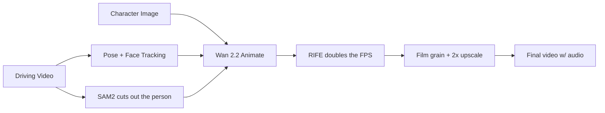

# BBQ Animate

**Drop in a photo of a character + a video of someone moving → get a video of your character doing that exact motion.** With audio, 60fps, and film grain so it doesn't look AI-smooth.

```
character image  +  driving video  →  character performing the video
```

---

## How it works



1. **Track** — AI finds the skeleton + face of the person in your video, frame by frame
2. **Cut** — SAM2 masks out the original person so your character can take their place
3. **Generate** — Wan 2.2 Animate 14B puppets your character onto that skeleton
4. **Polish** — 30fps to 60fps interpolation, film grain, upscale to 1440x2560, audio muxed back in